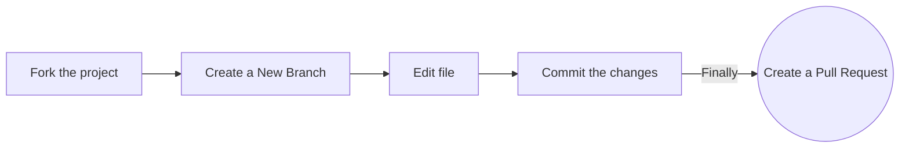

<div align="center">
  <a href="https://www.recodehive.com">
  
  </a>
</div>

<br>

<div align="center">

[](https://github.com/recodehive/recode-website/stargazers)
[](https://github.com/recodehive/recode-website/network/members)
[](https://github.com/recodehive/recode-website/pulls?q=is%3Apr+is%3Aclosed)
[](https://github.com/recodehive/recode-website/issues)
[](https://github.com/recodehive/recode-website/graphs/contributors)


<h2 align="center">Collaboration 1st , code 2nd.</h2>

recode hive is an open-source project where developers learn by collaborating, get paid for technical writing, and gain access to real-world projects and sponsorship opportunities.

[Website](https://recodehive.com/) • [Documentation](https://recodehive.com/docs) • [Contributing](community/contributing-guidelines.md) • [Discord](https://discord.gg/Yxv9RA3r)

</div>

---


> [!IMPORTANT]
> Get the recode hive source from [recodehive/recode-website](https://github.com/recodehive/recode-website) or the live site at [recodehive.com](https://www.recodehive.com).<br>
> A similar repository name or copied README does not establish that a download is official.

> Prerequisites

> [Node.js](https://nodejs.org/) 20.9 – 22 (see `.nvmrc`)<br>
> [Docker](https://docs.docker.com/engine/install/) (optional, for containerized development)
> Docker Compose (optional)


### Contribution Workflow

We welcome contributions from developers of all skill levels! Here's how you can get started:



### Step-by-Step Guide

**Fork and clone the repository**, then get it running by following [Installation](#installation).

**Create a new branch:**

```bash
git checkout -b feature/your-feature-name
```

**Make your changes** and test thoroughly.

**Commit your changes:**

```bash
git commit -m "Add: brief description of your changes"
```

**Push to your fork:**

```bash
git push origin feature/your-feature-name
```

**Submit a Pull Request** with a detailed description of your changes

**Fork the repository** on GitHub, then clone your fork:

```bash
git clone https://github.com/<your-username>/recode-website.git
cd recode-website
```

**Set up environment variables** (optional, avoids GitHub API rate limits and enables live data):

```bash
cp .env.example .env
# then add your GITHUB_TOKEN and DOCUSAURUS_GIT_TOKEN
```

**Using Docker (Recommended):**

```bash
# Build the image (first time only)
docker build -t recodehive-app .

# Run the container
docker run -p 3000:3000 recodehive-app
```

**Using Docker Compose (with hot-reload):**

```bash
docker-compose up
```

Your application will be available at "http://localhost:3000"

**Traditional Setup:**

```bash
npm install
npm run start
```

### Production Build

> [!NOTE]
> The build first fetches releases, sponsors and community PRs from GitHub, so it needs network access. Set the tokens from `.env` to avoid rate limits.

```bash
npm run build
npm run serve
```


> [!NOTE]
> Tech Stack
>- **Framework:** Docusaurus 3 (React + TypeScript)
>- **Language:** TypeScript (Node.js ≥ 18)
>- **Styling:** Tailwind CSS 4
>- **UI Components:** Radix UI, Framer Motion

> [!WARNING]
>- **Linting & Formatting:** ESLint, Prettier
>- **Type Checking:** TypeScript (`tsc`)

## 📁 Project Structure

| | Folder | What lives here |
| :-: | :-- | :-- |
| ⚙️ | [`.github/`](.github) | Issue & PR templates, workflows, README assets |
| ✍️ | [`blog/`](blog) | Blog posts |
| 🤝 | [`community/`](community) | Contributing guidelines and community docs |
| 📚 | [`docs/`](docs) | Main documentation (GitHub, Google Student Ambassador, …) |
| 🎓 | [`learn/`](learn) | Learning content |
| 🔌 | [`plugins/`](plugins) | Custom Docusaurus plugins |
| 🧰 | [`scripts/`](scripts) | Maintenance and build scripts |
| 🧩 | [`src/`](src) | Source code: components, pages, theme, styles, utils |
| 🗄️ | [`supabase/`](supabase) | Supabase configuration |
| 🖼️ | [`static/`](static) | Static assets: icons, images |
| 📖 | [`wiki/`](wiki) | Project wiki |

<details>
<summary><b>🔍 Expand the <code>src/</code> folder</b></summary>

| Folder | Purpose |
| :-- | :-- |
| `components/` | React components |
| `css/`, `styles/` | Global and custom styles |
| `data/`, `database/` | Static data and database helpers |
| `pages/` | Site pages |
| `plugins/`, `theme/` | Docusaurus plugins and theme overrides |
| `services/`, `lib/`, `utils/` | Services, shared libraries and helpers |

</details>


### Video Tutorial

<div align="center">

> [!TIP]
> New here? Watch this walkthrough of how to set up the project and make your first contribution.

<a href="https://www.loom.com/share/c8d8d5f0c2534a1f86fc510dcef52ee0">
  
</a>

<br><br>

[](https://www.loom.com/share/c8d8d5f0c2534a1f86fc510dcef52ee0)
[](https://www.recodehive.com/docs/first-time-setup)
[](community/contributing-guidelines.md)

</div>

## 📚 Documentation

- [Contributing Guidelines](community/contributing-guidelines.md)
- [Code of Conduct](https://www.recodehive.com/code-of-conduct)
- [Understanding Lint Checks](community/understand-lint-checks.md)
- [Our Documentation Standards](community/our-documentation.md)

## 📊 Project Statistics


[](https://github.com/recodehive/recode-website/LICENSE)


## 👥 Contributors

We appreciate all contributions to recode hive! Thank you to everyone who has helped make this project better.

<!-- contributors:start -->

<a href="https://github.com/sanjay-kv"></a> <a href="https://github.com/Adez017"></a> <a href="https://github.com/steam-bell-92"></a> <a href="https://github.com/sheikhlimon"></a> <a href="https://github.com/Richajaishwal0"></a> <a href="https://github.com/hrx01-dev"></a> <a href="https://github.com/kanishka-commits"></a> <a href="https://github.com/sohumvenkatadri7"></a> <a href="https://github.com/Abhash-Chakraborty"></a> <a href="https://github.com/codewithdhruba01"></a>
<a href="https://github.com/smirk-dev"></a> <a href="https://github.com/singh-odyssey"></a> <a href="https://github.com/Shitanshukumar607"></a> <a href="https://github.com/Condition00"></a> <a href="https://github.com/ShivanshPlays"></a> <a href="https://github.com/vansh-codes"></a> <a href="https://github.com/Samridha0305"></a> <a href="https://github.com/yashksaini-coder"></a> <a href="https://github.com/abhishekkalme"></a> <a href="https://github.com/aaniya22"></a>
<a href="https://github.com/dinesh-2047"></a> <a href="https://github.com/srushti-panara"></a> <a href="https://github.com/Ayushgupta2408"></a> <a href="https://github.com/sachinggsingh"></a> <a href="https://github.com/Shayan-Bhowmik"></a> <a href="https://github.com/SamXop123"></a> <a href="https://github.com/Codeboy20"></a> <a href="https://github.com/gmarav05"></a> <a href="https://github.com/NssGourav"></a> <a href="https://github.com/meetoza30"></a>
<a href="https://github.com/Gupta-02"></a> <a href="https://github.com/mdazfar2"></a> <a href="https://github.com/tsvlgd"></a> <a href="https://github.com/Bushra-gh"></a> <a href="https://github.com/Astha-coder-web"></a> <a href="https://github.com/iitzIrFan"></a> <a href="https://github.com/diya-india"></a> <a href="https://github.com/anjany06"></a> <a href="https://github.com/prinshu756"></a> <a href="https://github.com/saurabhhhcodes"></a>
<a href="https://github.com/santhosh-005"></a> <a href="https://github.com/Papia-tech"></a> <a href="https://github.com/nancy-verma780"></a> <a href="https://github.com/MiniduOshan"></a> <a href="https://github.com/medss19"></a> <a href="https://github.com/Abhi0049k"></a> <a href="https://github.com/mukeshdhadhariya"></a> <a href="https://github.com/Ronaldo-001"></a> <a href="https://github.com/101xVishal"></a> <a href="https://github.com/Tannuu18"></a>
<a href="https://github.com/harish599"></a> <a href="https://github.com/buzztouniverse"></a> <a href="https://github.com/Vijayaa21"></a> <a href="https://github.com/Shivamagrawal20"></a> <a href="https://github.com/AyushKatre05"></a> <a href="https://github.com/diksha78dev"></a> <a href="https://github.com/Khushalsarode"></a> <a href="https://github.com/CopperFlame14"></a> <a href="https://github.com/ManikaAgarwal02"></a> <a href="https://github.com/KAYO-ult"></a>
<a href="https://github.com/Sricharan106"></a> <a href="https://github.com/rutujdhawale"></a> <a href="https://github.com/areebniyas"></a> <a href="https://github.com/VinothanaBalakrishnan05"></a> <a href="https://github.com/utkarshpathak14"></a> <a href="https://github.com/SoumyaEXE"></a> <a href="https://github.com/ItsAbhinavM"></a> <a href="https://github.com/mrdeyroy"></a> <a href="https://github.com/nishtha-agarwal-211"></a> <a href="https://github.com/prkr-28"></a>
<a href="https://github.com/iaadillatif"></a> <a href="https://github.com/vaemaski"></a> <a href="https://github.com/vishalm342"></a> <a href="https://github.com/Yash456k"></a> <a href="https://github.com/AK1007-2007"></a> <a href="https://github.com/adiprem73"></a> <a href="https://github.com/anujos"></a> <a href="https://github.com/akofficial10"></a> <a href="https://github.com/bh462007"></a> <a href="https://github.com/Julliet-Mohanta"></a>
<a href="https://github.com/khushi-joshi-05"></a> <a href="https://github.com/mitalikapil"></a> <a href="https://github.com/developer-mohitsoni"></a> <a href="https://github.com/divysaxena24"></a> <a href="https://github.com/nikunj-kohli"></a> <a href="https://github.com/OmanshiRaj"></a> <a href="https://github.com/pericharlabindhumadhavi-data"></a> <a href="https://github.com/PIYUSH-NEXTGEN"></a> <a href="https://github.com/PranshuPujara"></a> <a href="https://github.com/RAJVEER42"></a>
<a href="https://github.com/ruchspatil"></a> <a href="https://github.com/SOMNATH0904"></a>

<!-- contributors:end -->


## 📬 Stay Connected

Stay up to date with the latest from recode hive:

<p align="center">
  <a href="https://recodehive.com/"></a>
  <a href="https://www.instagram.com/nomadbrains.dev/"></a>
  <a href="https://www.linkedin.com/in/sanjay-k-v/"></a>
  <a href="https://x.com/nomadbrainsdev"></a>
  <a href="https://www.youtube.com/@RecodeHive"></a>
  <a href="https://recodehive.substack.com/"></a>
</p>

---

<div align="center">

**Happy open-source contributions, collaboration 1st and code 2nd! 🎉** <br>
Made with ❤️ by the recode hive community


<p align="center">
  
</p>


<a href="#top">
  
</a>

</div>